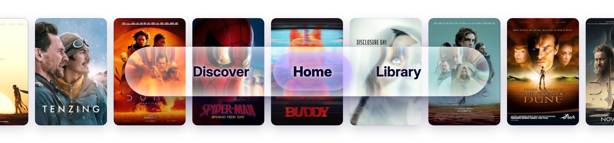
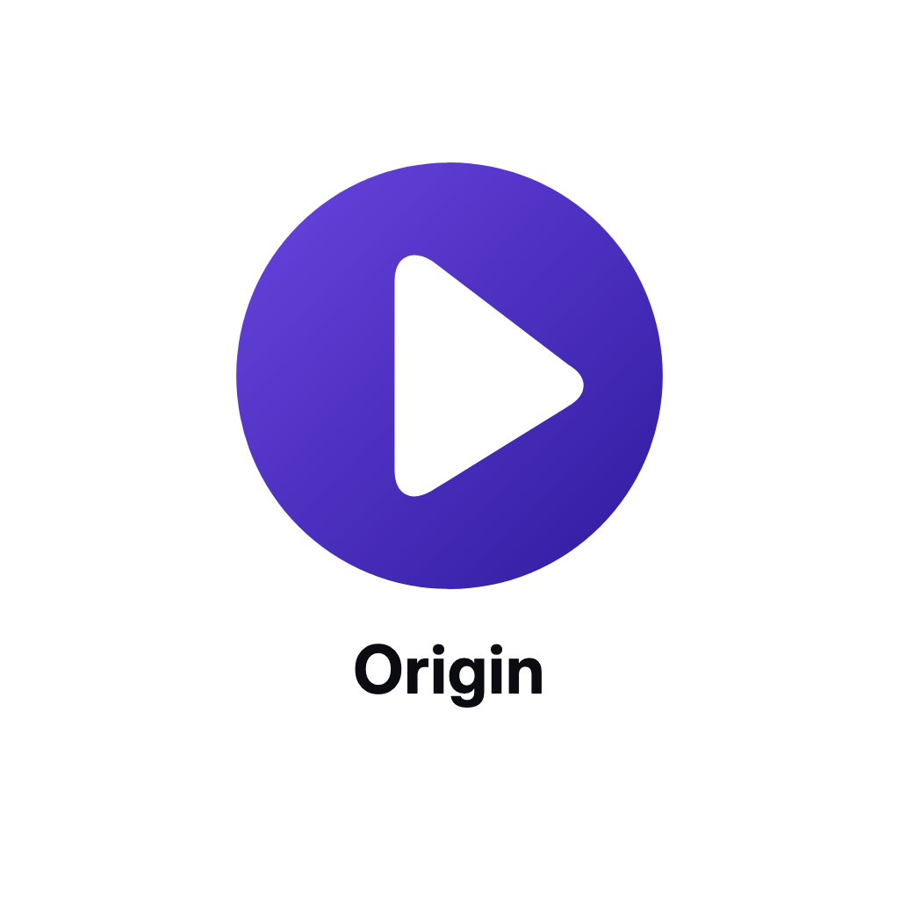
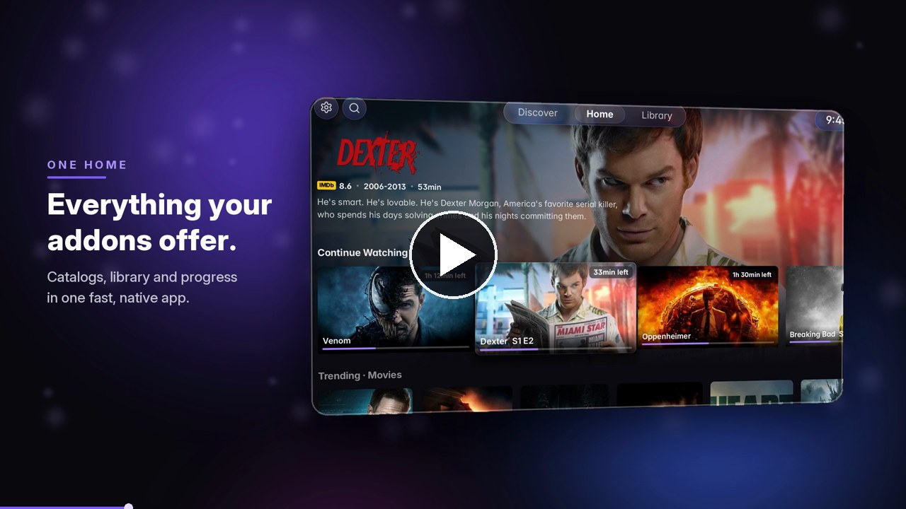

<p align="center">
  
</p>

<h1 align="center">ORIGIN</h1>

<p align="center"><b>A media center for your addons on LG webOS TVs. Native, fast and quiet, with your Stremio account and addons.</b></p>

<p align="center">
  <a href="https://github.com/slvjtr1/origin/releases/latest"></a>
  
  
</p>

<p align="center">
  <a href="https://slvjtr1.github.io/origin/promo.mp4"></a><br>
  <sub><a href="https://slvjtr1.github.io/origin/promo.mp4">▶ Watch Origin in 24 seconds</a> (with sound)</sub>
</p>

<p align="center"><sub>Origin plays what Stremio™ addons offer. Stremio is a trademark of its owner; Origin is independent and unofficial, and is not affiliated with, endorsed by or sponsored by Stremio.</sub></p>

> **Android TV and Google TV:** ORIGIN is now made for LG webOS only. For Android TV and Google TV, the original project has its own app: **[Stremio Origin for Android TV](https://stremioorigin.com/android-tv/)** ([source on GitHub](https://github.com/stremio-origin/androidtv)).

---

## What it does

### Watching
| | |
|---|---|
| **The best stream, in one press** | Play picks the source that suits your TV and your connection: resolution, HDR, sound, size and health are read from every source. It is chosen as soon as a good one is there. |
| **A source fails, the next one plays** | When a source does not play, the next best one starts by itself, then a third. If all three fail, the page says so and lets you choose from them. |
| **Super clean sources** | Programs, archives and fake files are left out. So are sources of another episode or season, of another title with a similar name (a spin-off, a sequel, a film of another year) and cinema recordings; a torrent pack plays the episode you opened. The list says how many were left out and shows them if you ask. |
| **The wrong video never comes back** | A source that plays something else than what you opened is noticed by the player (the file's own title, its length), skipped, and kept out of the lists from then on. You can mark one yourself from the sources list. |
| **Live TV** | Channels and sports from your live addons, with Favorites and Recent. A channel that stops switches to another stream of it by itself. |
| **Seek previews** | A picture of the film over the seek bar as you move through it, for debrid and direct links. |
| **Chapters** | The film's chapters on the seek bar and in the seek pill. |
| **Torrents built in** | Played straight from the swarm with a buffer sized to your TV's memory. A USB drive is set up by itself when you plug it in (an SSD works best). |
| **Skip intro, recap and credits** | A button at the right moment. Press OK, or let it skip by itself. |
| **Next episode** | Starts by itself, from the same source group when there is one, with a large or compact card. |
| **Trailers** | A title's trailer plays behind its page and fills the screen after five seconds, in the sharpest picture its source has. |
| **A player bar of icons** | The picture on the left (upscale, picture size), the film in the middle (from the beginning, back, play, forward, next episode; your seek step written on the arrows), episodes, sources, sound and subtitles on the right. |

### Picture and sound
| | |
|---|---|
| **DTS** | Converted on the TV when it cannot play it. |
| **HDR and Dolby Vision** | Shown as they are on TVs that support them; Blu-ray copies converted to show in Dolby Vision. |
| **Upscale** | The TV's own Super Resolution, for films and for anime (needs Homebrew Channel root). |
| **Brightness, See in the dark** | The TV's light, gamma and tone mapping set while you watch and put back after (needs Homebrew Channel root). |
| **Clear voice, Even volume** | Speech brought forward and loud scenes held back by the TV's own processors. |
| **Audio language** | Your language whenever the file has it; anime in Japanese unless you choose another. What you pick for a show stays for the whole show. |

### Subtitles
| | |
|---|---|
| **Picked for you** | From your addons, OpenSubtitles and the file itself, in your language. Forced only, if you want just the lines in another language and the signs. What you pick for a show stays for the whole show. |
| **OpenSubtitles Pro, built in** | More subtitles and none of the spam: with AI translations, made by people only, or off. The standard service answers when it is away. |
| **In sync** | Checked against other releases and brought into step by themselves; one press to adjust. |
| **Your way** | Size, 20 fonts for Latin and Arabic, bold, colours, brightness, outline, shadow, background and position, set while you watch. Styled ASS and SSA subtitles drawn as the film intends. Sound descriptions, adverts and credits hidden. Old encodings read in the subtitle's own language. Arabic joined and right to left. |

### Finding things
| | |
|---|---|
| **Home and Discover** | Every catalog from your addons, then TMDB's lists up to the number you choose, titles and descriptions in your language. |
| **Search** | Films and series from well-known services, without clips and fan uploads, and film collections. Your recent searches kept. |
| **Title pages** | Cast, reviews, similar titles, collections, awards, countries, seasons with watched marks. |
| **No spoilers** | Episodes you haven't watched: their pictures blurred, and their stories hidden too if you like. |

### Yours
| | |
|---|---|
| **Library and progress** | Library, watched episodes and Continue Watching follow your account. Film collections in the Library. |
| **Trakt** | What you watch tracked, watched marks, Continue Watching from other apps and Trakt rows on Home. Bring your own Trakt Client ID: Settings › Trakt shows how. |
| **Several accounts** | Kept on the TV, a press apart. |
| **Look** | Twenty accent colours, or the colours of the title you open; card corners; a 12 or 24 hour clock; a screensaver. |
| **Your subtitle languages** | Pick one or more (English and Arabic, say): only those show, from addons and OpenSubtitles. |
| **Updates from inside** | Settings › About. Beta updates are a switch away, never installed by themselves. |

## Install

**LG webOS 3 and later (ARM)**
- Homebrew Channel (rooted TVs): add the repository `https://slvjtr1.github.io/origin/apps.json`, then install Origin.
- Developer Mode: download `tv.stremioorigin.app_<version>_arm.ipk` from the [latest release](https://github.com/slvjtr1/origin/releases/latest) and install it with [webOS Dev Manager](https://github.com/webosbrew/dev-manager-desktop).

New versions install from inside the app: **Settings › About**. Install steps and help are also on the [site](https://slvjtr1.github.io/origin/). See [compatibility](docs/compatibility.md).

**Android TV and Google TV:** use [Stremio Origin for Android TV](https://stremioorigin.com/android-tv/) from the original project ([GitHub](https://github.com/stremio-origin/androidtv)).

## Good to know

- **Language:** ORIGIN is in English only for now. We are sorry to everyone who used it in Arabic: Arabic caused big problems in building the app, and for now the app needs English alone. Arabic subtitles are still fully supported: choose them in the subtitle settings.
- **Trakt** needs a Client ID of your own (free, from Trakt's API apps page): Settings › Trakt shows how and takes it from your phone.
- **Links from addons** show a code: scan it and the site opens the link on your phone.
- **Something wrong?** Settings › About › Share logs, then scan the code: the site fills in the report.
- **Upscale and the other picture settings** need Homebrew Channel with root.

## Privacy and safety

- Sign-in goes directly to Stremio. Your account stays on the TV, in a file only the app reads.
- No analytics. Nothing is sent to the developer.
- Logs stay on the TV. Sharing them is your choice: the app seals them and shows a short code.
- The app asks only web addresses, and takes its updates only from this project's releases, checked against their checksum.
- You are responsible for having the right to watch what your addons offer.

## Building

```sh
tools/build.sh webos        # the LG webOS app
tools/release.sh X.Y.Z      # version, package and checksum in dist/, the site's Homebrew files in docs/
```

## Credits

- Built on [Stremio Origin](https://github.com/stremio-origin/webos) by simussu.
- Interface sounds: [Interface Sounds](https://kenney.nl/assets/interface-sounds) by Kenney (CC0).
- Subtitle fonts: [Google Fonts](https://github.com/google/fonts) (SIL Open Font License 1.1).
- Libraries and their licences: `third_party/licenses`.

## Licence

GPL-3.0. See [LICENSE](LICENSE).
