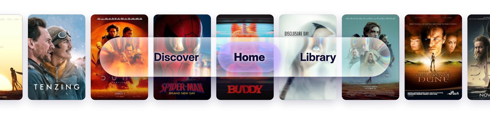
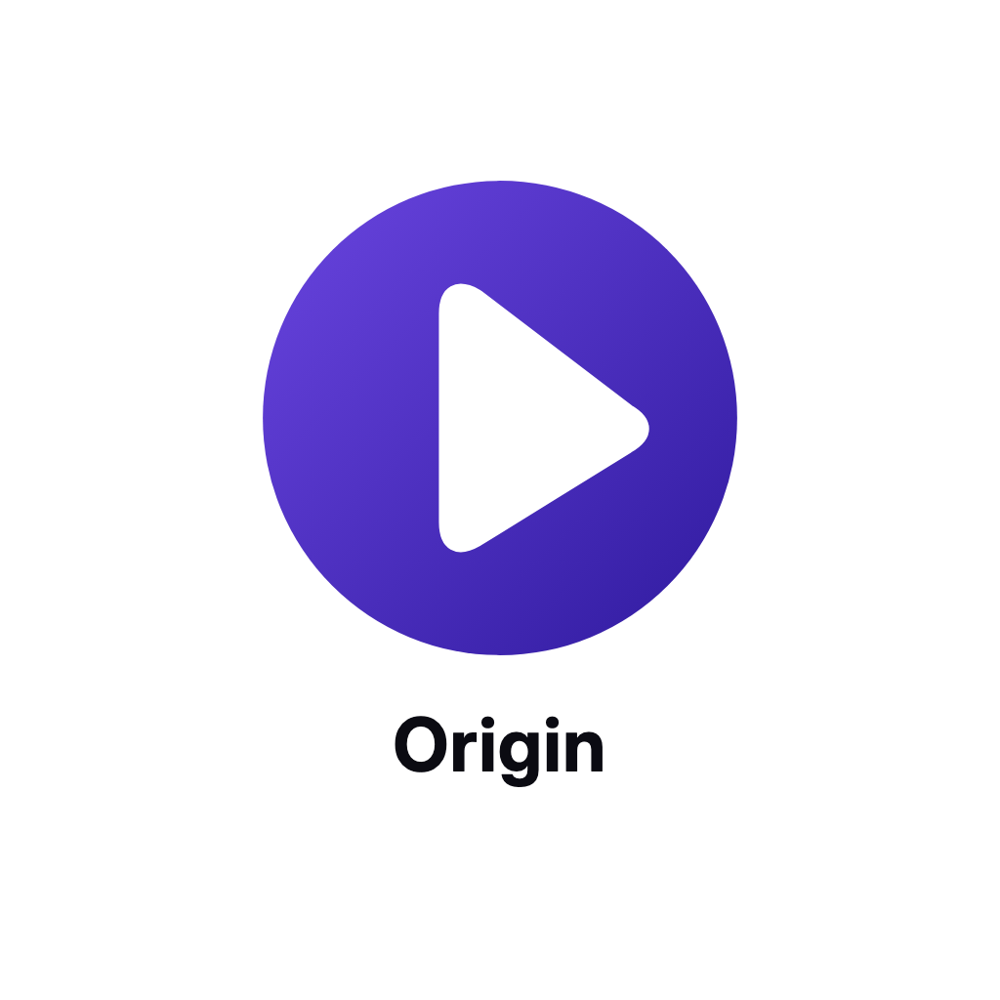

<p align="center">
  
</p>

<h1 align="center">ORIGIN</h1>

<p align="center"><b>A media center for your addons on LG webOS and Google TV. Native, written in C: fast, quiet, in English or Arabic.</b></p>

<p align="center">
  <a href="https://github.com/slvjtr1/origin/releases/latest"></a>
  
  
  
</p>

<p align="center"><sub>Origin plays what Stremio™ addons offer. Stremio is a trademark of its owner; Origin is independent and unofficial, and is not affiliated with, endorsed by or sponsored by Stremio.</sub></p>

---

## What it does

### Watching
| | |
|---|---|
| **The best stream, in one press** | Play picks the source that suits your TV and your connection: resolution, HDR, sound, size and health are read from every source. It is chosen as soon as a good one is there. |
| **A source fails, the next one plays** | When a source does not play, the next best one starts by itself, then a third. If all three fail, the page says so and lets you choose from them. |
| **Clean sources** | Programs, archives and fake files are left out. For a series, sources of another episode or season are left out, and a torrent pack plays the episode you opened. |
| **Torrents built in** | Played straight from the swarm with a buffer sized to your TV's memory, or kept on a USB drive on LG webOS. |
| **Skip intro, recap and credits** | A button at the right moment. Press OK, or let it skip by itself. |
| **Next episode** | Starts by itself, from the same source group when there is one. |
| **Trailers** | A title's trailer plays behind its page and fills the screen after five seconds. |

### Picture and sound
| | |
|---|---|
| **Sound on every device** | Google TV: the TV's own decoders first; the app's own decoders for Dolby Digital, Dolby Digital Plus, DTS and TrueHD on devices without them; a second player (VLC) for anything left. LG webOS: DTS converted on the TV. |
| **HDR and Dolby Vision** | Shown as they are on TVs that support them. |
| **The film's frame rate** | Google TV switches the screen to 24, 25 or 50 Hz with the film when the TV allows it. |
| **Upscale** | LG webOS: the TV's own Super Resolution, for films and for anime (needs Homebrew Channel root). Google TV: a graphics-chip pass for HD and lower. |
| **Audio language** | Your language whenever the file has it; anime in Japanese unless you choose another. |

### Subtitles
| | |
|---|---|
| **Picked for you** | From your addons, OpenSubtitles and the file itself, in your language. |
| **In sync** | Checked against other releases and brought into step by themselves; one press to adjust. |
| **Your way** | Size, six fonts, bold, colours, outline, shadow, background and height. Styled ASS and SSA subtitles drawn as the film intends. Sound descriptions hidden. Arabic joined and right to left. |

### Finding things
| | |
|---|---|
| **Home and Discover** | Your addons' catalogs first, 8 to 24 rows on Home, titles and descriptions in your language. |
| **Search** | Films and series from well-known services, without clips and fan uploads. By voice on Google TV. Your recent searches kept. |
| **Title pages** | Cast, reviews, similar titles, awards, countries, seasons with watched marks. |
| **No spoilers** | Blur unwatched episodes: their pictures and stories stay hidden until you watch them. |

### Yours
| | |
|---|---|
| **Library and progress** | Library, watched episodes and Continue Watching follow your account. |
| **Several accounts** | Kept on the TV, a press apart. |
| **Look** | Twenty accent colours, or the colours of the title you open; card corners; a 12 or 24 hour clock; a screensaver. |
| **Arabic or English** | The whole app, end to end. |
| **Updates from inside** | Settings › About. Beta updates are a switch away, never installed by themselves. |

## Install

**LG webOS 3 and later (ARM)**
- Homebrew Channel (rooted TVs): add the repository `https://slvjtr1.github.io/origin/apps.json`, then install Origin.
- Developer Mode: download `tv.stremioorigin.app_<version>_arm.ipk` from the [latest release](https://github.com/slvjtr1/origin/releases/latest) and install it with [webOS Dev Manager](https://github.com/webosbrew/dev-manager-desktop).

**Google TV and Android TV 9 and later**
- In the [Downloader](https://www.aftvnews.com/downloader/) app, enter the code **7619746**: it downloads the latest APK. Or download [`Origin-AndroidTV.apk`](https://github.com/slvjtr1/origin/releases/latest/download/Origin-AndroidTV.apk) and allow installs when Android asks.

New versions install from inside the app: **Settings › About**. Install steps and help are also on the [site](https://slvjtr1.github.io/origin/). See [compatibility](docs/compatibility.md).

## Good to know

- **Language:** Settings › Language. The app follows the TV's language until you choose one.
- **Links from addons** show a code: scan it and the site opens the link on your phone.
- **Something wrong?** Settings › About › Share logs, then scan the code: the site fills in the report.
- **Upscale and the other picture settings on LG webOS** need Homebrew Channel with root.

## Privacy and safety

- Sign-in goes directly to Stremio. Your account stays on the TV, in a file only the app reads.
- No analytics. Nothing is sent to the developer.
- Logs stay on the TV. Sharing them is your choice: the app seals them and shows a short code.
- The app asks only web addresses, and takes its updates only from this project's releases, checked against their checksum.
- You are responsible for having the right to watch what your addons offer.

## Building

```sh
tools/build.sh webos        # the LG webOS app
tools/release.sh X.Y.Z      # version, packages and checksums in dist/, the site's Homebrew files in docs/
```

The Google TV app is in `ports/androidtv` (Gradle); `tools/release.sh` builds it too when a signing file is given.

## Credits

- Built on [Stremio Origin](https://github.com/stremio-origin/webos) by simussu.
- Interface sounds: [Interface Sounds](https://kenney.nl/assets/interface-sounds) by Kenney (CC0).
- Libraries and their licences: `third_party/licenses`.

## Licence

GPL-3.0. See [LICENSE](LICENSE).
